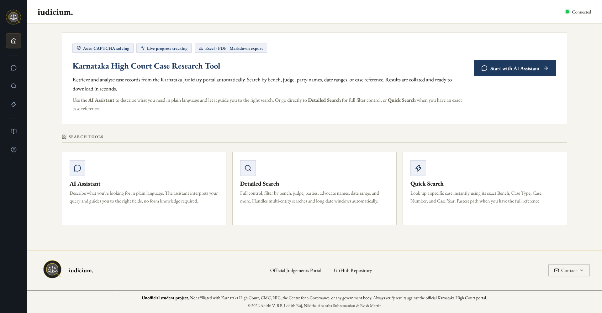
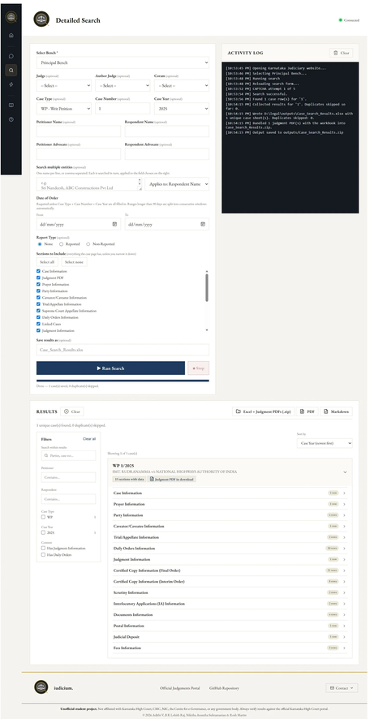
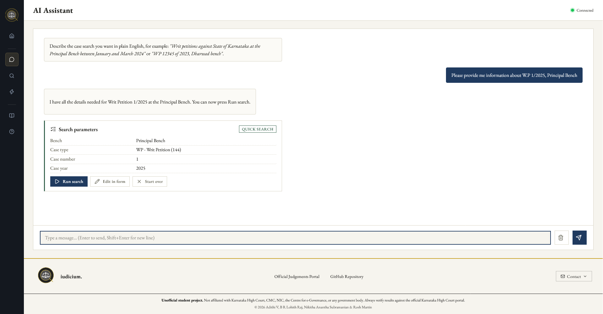

# Iudicium


> An automated case-search and reporting tool for the Karnataka Judiciary case-status portal, with a React web UI, Google sign-in restricted to an allow-list, a per-person search history, a conversational AI assistant for building searches, and consolidated Excel export.

Iudicium drives the Karnataka Judiciary's case-status search page (`rep_judgment.php`) end to end: it fills in the real search form, solves the site's CAPTCHA with OCR, works through every matching result, opens each case's detail page, and compiles everything into one Excel workbook. It also supports the site's separate "Quick Search by Case No." page for direct lookups.

**This is version 2.** The application is now a JavaScript stack (React + Express on Node.js). Python is used for exactly one job: the scraper that drives the browser and reads the CAPTCHA.

## Table of Contents

- [Screenshots](#screenshots)
- [Key Features](#key-features)
- [Architecture](#architecture)
- [Repository Structure](#repository-structure)
- [Installation](#installation)
- [Google sign-in](#google-sign-in)
- [Accounts and search history](#accounts-and-search-history)
- [Running the Application](#running-the-application)
- [Configuration Reference](#configuration-reference)
- [API Reference](#api-reference)
- [Scraper Worker Protocol](#scraper-worker-protocol)
- [Output](#output)
- [Testing](#testing)
- [Docker and Deployment](#docker-and-deployment)
- [Operational Notes](#operational-notes)
- [What Changed from v1](#what-changed-from-v1)
- [License](#license)

## Screenshots

**Home**



**Detailed Search**



**AI Assistant**



*(Screenshots are from v1; the interface is unchanged.)*

## Key Features

* **Detailed Search**: every field the live site exposes (bench, judge, author judge, coram, case type/number/year, party and advocate names, date of order, report type), plus multi-entity searches and automatic splitting of date ranges longer than the site's 90-day limit.
* **Quick Search**: direct lookup by bench, case type, number and year.
* **AI Assistant**: describe a search in plain English. The model only interprets language; every value it proposes is validated in code against the real form options, and the server (not the model) decides whether enough has been provided to run. After a search, it can answer questions about and summarise the fetched cases.
* **Automatic CAPTCHA solving** with Tesseract, with retries.
* **Live progress** (log lines, progress bar) streamed over a WebSocket, and a stop button that saves what was collected so far.
* **Results explorer**: filter, sort, and expand each case section by section.
* **Google sign-in, allow-listed**: the site opens on a login page; only the emails listed in `server/src/allowedEmails.js` can get in.
* **Search history**: every search (from the forms or the AI Assistant) is saved to your account with a **Run again** button that reopens the right search page and runs it.
* **Exports**: Excel workbook (with the judgment PDFs zipped alongside when captured), PDF and Markdown.

## Architecture

```
 Browser (React, Vite)
   │  REST (/api/*)   WebSocket (/ws/logs)   downloads (/outputs/*)
   ▼
 Node.js + Express  ───────────────────────────────────────────────
   │  Google sign-in + allow-list      SQLite: accounts, sessions, search history
   │  routes + zod validation          AI assistant + LLM client
   │  job manager (one job at a time)  ExcelJS workbook writer, zip bundling
   │
   │  spawn: python -m scraper.worker <detailed|quick|judges> <spec.json>
   │  stop   ← a stop file the worker polls
   │  stdout → events (JSON lines): log, progress, case_progress, result, error
   ▼
 Python scraper worker (Playwright + Tesseract)  ──►  Karnataka Judiciary website
```

Why this split:

* **Python stays for the scraper** because Playwright + pytesseract + the existing extraction code are a good fit and already work against the live site. The worker contains no web server, no Excel code, and no AI code.
* **Node owns everything else**: the HTTP API, WebSocket, the job queue, the AI assistant, validation and the Excel export.
* **One source of truth for form data.** `shared/config.json` (bench codes, case types, years, coram, report types, case-detail sections, retry limits) is read by both the Node server and the Python scraper.
* **Safe by construction**: the worker stops by itself if the server disappears, so a scraper is never left running unattended; a scraper that ignores a stop request is killed (with its browser) after a grace period.

## Repository Structure

```
iudicium/
├── client/                    React app (Vite)
│   ├── src/
│   │   ├── pages/             Login, Home, DetailedSearch, QuickSearch, Assistant, Account, Guide, Faq
│   │   ├── components/        Layout, Footer, ResultsPanel, SectionViews, FormParts, ...
│   │   ├── hooks/             useSearchJob, useFormOptions
│   │   ├── context/           SocketContext (shared WebSocket)
│   │   ├── utils/             api, storage, results, PDF/Markdown export
│   │   └── styles.css
│   └── test/                  Vitest + Testing Library UI tests
├── server/                    Express API (ESM)
│   ├── src/
│   │   ├── index.js           HTTP + WebSocket server
│   │   ├── app.js             Express app (static files, downloads, errors)
│   │   ├── allowedEmails.js   WHO MAY SIGN IN (edit this)
│   │   ├── ws.js              live-updates WebSocket (signed-in, per-person)
│   │   ├── config.js          env + shared config
│   │   ├── routes/api.js      REST endpoints
│   │   ├── services/
│   │   │   ├── jobManager.js  runs the Python worker, builds outputs
│   │   │   ├── assistant.js   AI assistant logic and validation
│   │   │   ├── llm.js         Gemini / OpenAI-compatible client
│   │   │   ├── excelWriter.js workbook generation (ExcelJS)
│   │   │   ├── bundle.js      zip workbook + judgment PDFs
│   │   │   ├── auth.js        Google sign-in, sessions, allow-list check
│   │   │   ├── store.js       SQLite: users, sessions, search history
│   │   │   ├── validation.js  request schemas and rules
│   │   │   └── reference.js   lookup tables from shared/config.json
│   │   └── utils/text.js
│   └── test/                  node:test suites (incl. a fake worker)
├── scraper/                   Python: the only Python in the project
│   ├── worker.py              CLI entry point (JSON-lines protocol)
│   ├── search_engine.py       Detailed Search orchestration
│   ├── case_number_search.py  Quick Search orchestration
│   ├── judge_lookup.py        live judge dropdown options
│   ├── captcha.py, case_extraction.py, section_structure.py, pdf_capture.py, ...
│   └── mock.py                synthetic data for UI work (SCRAPER_MOCK=true)
├── shared/config.json         form/reference data used by Node and Python
├── Dockerfile  deploy.sh  requirements.txt  package.json  .env.example
```

## Installation

You need **Node.js 18.18+**, **Python 3.11+** and **Tesseract OCR**.

```bash
# 1. JavaScript dependencies (installs server and client, npm workspaces)
npm install

# 2. Python dependencies, for the scraper only
python -m venv .venv
source .venv/bin/activate          # Windows: .venv\Scripts\activate
pip install -r requirements.txt
playwright install chromium

# 3. Configuration
cp .env.example .env               # then edit it (see below)
```

**Tesseract**: install it from your OS package manager (`apt install tesseract-ocr`, `brew install tesseract`) or, on Windows, the [UB Mannheim installer](https://github.com/UB-Mannheim/tesseract/wiki). If it is not on your `PATH`, set `TESSERACT_CMD` in `.env`. The usual install locations are detected automatically.

**Which Python does the server use?** In order: `PYTHON_BIN` from `.env`, the active virtual environment (`VIRTUAL_ENV`), a `.venv`/`venv`/`env` folder in the project, then `python` (Windows) or `python3`. The scraper packages must be installed in *that* Python. The server checks this when it starts (see the terminal output) and again before every search, and tells you exactly what is missing.

**Sign-in**: before anyone can use the app you must set `GOOGLE_CLIENT_ID` and list the allowed emails; see [Google sign-in](#google-sign-in) just below.

**Gemini API key** (for the AI Assistant): create one at <https://aistudio.google.com/apikey> and put it in `.env` as `GEMINI_API_KEY`. To use an OpenAI-compatible provider instead, set `LLM_PROVIDER=openai` and the `OPENAI_*` variables.

## Google sign-in

The site opens on a login page with one button, "Sign in with Google". Nothing else is reachable until you are signed in, and only Google accounts whose email is in the allow-list may enter.

**1. Allow-list.** Open `server/src/allowedEmails.js` and replace the placeholder with the real addresses, one per line. Restart the server after editing. Removing an address locks that person out immediately, even if they are signed in.

**2. Google client ID** (free, about five minutes):

1. Go to <https://console.cloud.google.com/apis/credentials> and pick or create a project.
2. If asked, set up the **OAuth consent screen**: user type *External*, an app name, your email. While the app is in *Testing*, add your allowed emails under **Test users**.
3. **Create credentials → OAuth client ID → Web application.**
4. Under **Authorized JavaScript origins** add every address you open the site at, exactly: `http://localhost:5173` (development), `http://localhost:8000` (production build), and your deployed URL. No redirect URIs are needed.
5. Copy the client ID (it ends in `.apps.googleusercontent.com`) into `.env` as `GOOGLE_CLIENT_ID=...` and restart.

If Google shows "Error 400: origin_mismatch", the address in your browser is not in the list from step 4. The server prints a warning at startup if `GOOGLE_CLIENT_ID` is missing or the allow-list is still the placeholder.

**How it works.** Google gives the browser a signed ID token; the server verifies it against Google's public keys, requires a verified email, checks the allow-list, then starts a session in an `HttpOnly`, `SameSite=Lax` cookie (only a hash of the session token is stored). Everything under `/api`, the downloads and the WebSocket require that session, and requests that come from another website are refused.

## Accounts and search history

A SQLite database (default `data/iudicium.db`, created automatically; change it with `DATABASE_PATH`) stores:

* **accounts**: your name and photo (from your Google account), email and last sign-in;
* **sessions**: who is signed in (hashed tokens);
* **searches**: every search you run, with its parameters, whether it came from a form or the AI Assistant, its outcome (completed / stopped / failed) and case count. The newest 500 per person are kept.

Open **Account & history** in the sidebar (or your name in the top bar) to see them. **Run again** opens Detailed Search or Quick Search with the form filled in and starts the same search immediately. Searches made through the AI Assistant are saved as the Detailed or Quick search they really were, so they re-run in the matching page. Results are not stored, only the search; running it again fetches fresh results.

People are kept apart: each person has their own history, activity log, results and download folder (`outputs/users/<id>/`), and you only see the progress of your own searches. Only one search runs at a time across the whole server; if someone else's is running, you are told to try again shortly.

**Back up** `data/iudicium.db` if the history matters to you. On Cloud Run the container disk is temporary, so mount a persistent volume at `/data` (see `deploy.sh`).

## Running the Application

**Development** (hot reload; open <http://localhost:5173>):

```bash
npm run dev
```

This starts the Express server on port 8000 and the Vite dev server on 5173, which proxies `/api`, `/outputs` and the WebSocket to Express.

**Development without the court website or CAPTCHAs** (synthetic data, ideal for UI work):

```bash
npm run dev:mock
```

**Production** (Express serves the built React app itself; open <http://localhost:8000>):

```bash
npm run build
npm start
```

The old page URLs (`/search.html`, `/case-number.html`, ...) redirect to the new routes, so bookmarks keep working.

## Configuration Reference

All settings live in `.env` at the project root (see `.env.example`).

| Variable | Default | Purpose |
|---|---|---|
| `LLM_PROVIDER` | `gemini` | `gemini` or `openai` |
| `GEMINI_API_KEY`, `GEMINI_MODEL` | – / `gemini-3.6-flash` | Gemini settings |
| `OPENAI_API_KEY`, `OPENAI_MODEL`, `OPENAI_BASE_URL` | – / `gpt-4o-mini` / OpenAI | Any OpenAI-compatible endpoint (Groq, Ollama, vLLM, ...) |
| `PYTHON_BIN` | auto (venv, else `python`/`python3`) | Interpreter used to start the scraper worker |
| `TESSERACT_CMD` | auto-detect | Path to the Tesseract binary |
| `SCRAPER_HEADLESS` | `true` | `false` shows the browser window |
| `SCRAPER_MOCK` | off | `true` uses synthetic data instead of the live site |
| `STOP_GRACE_MS` | `60000` | How long a scraper may take to stop before it is killed |
| `GOOGLE_CLIENT_ID` | – | **Required.** Google OAuth web client ID for sign-in |
| `DATABASE_PATH` | `./data/iudicium.db` | SQLite file for accounts and search history |
| `SESSION_DAYS` | `7` | How long a sign-in lasts |
| `TRUST_PROXY` | off | `true` behind a proxy/load balancer that terminates HTTPS |
| `HOST`, `PORT` | `127.0.0.1`, `8000` | Server bind address |
| `OUTPUT_DIR` | `./outputs` | Workbooks, zips, judgment PDFs, debug snapshots |

Reference data (case types, years, coram, sections, the 90-day limit, retry count) is in `shared/config.json`.

## API Reference

| Method | Path | Purpose |
|---|---|---|
| GET | `/api/health` | Liveness check (open) |
| GET | `/api/auth/config` | Google client ID for the login page (open) |
| POST | `/api/auth/google` | Exchange a Google ID token for a session (open; allow-listed emails only) |
| GET | `/api/auth/me` | The signed-in user, or `null` (open) |
| POST | `/api/auth/logout` | End the session (open) |
| GET | `/api/history` | Your saved searches, newest first |
| DELETE | `/api/history/:id` | Forget one saved search |
| DELETE | `/api/history` | Forget them all (except one still running) |
| GET | `/api/form-options` | Dropdown data for the forms |
| POST | `/api/judges` | Live judge / author-judge options for a bench `{db_bench}` |
| POST | `/api/search` | Start a Detailed Search |
| POST | `/api/case-number-search` | Start a Quick Search |
| POST | `/api/search/stop` | Ask the running search to stop (keeps what was collected) |
| GET | `/api/search/status` | `{is_running, kind, job_id, last_job}` |
| GET | `/api/search/result` | The last finished search (fallback when a WebSocket message was missed) |
| GET | `/api/diagnostics` | Can the scraper run here? Python, packages, Chromium, Tesseract |
| GET / DELETE | `/api/logs/:page` | Buffered activity log; `page` is `search` or `case_number` |
| POST | `/api/assistant` | One conversational turn `{messages, fields, cases}` |
| POST | `/api/assistant/run` | Start the right search from validated fields |
| POST | `/api/ai-fill` | One-shot "sentence → form fields" |
| GET | `/outputs/:filename` | Download a finished `.xlsx` / `.zip` |
| WS | `/ws/logs` | Live events: `log`, `error`, `progress`, `case_progress`, `done` |

Everything except the endpoints marked *open* needs a signed-in session (`401` otherwise). Invalid requests get a `422` with a readable `error` message. Only one search runs at a time (`started: false` if another is running).

## Scraper Worker Protocol

`python -u -m scraper.worker <detailed|quick|judges> <spec.json>` reads its job from a JSON file (written by the server, with the search parameters plus `stop_file` and `parent_pid`) and writes one JSON event per line to stdout (stdout carries nothing else):

```json
{"type": "log",           "payload": "Searching 'Infosys' ..."}
{"type": "progress",      "payload": {"done": 1, "total": 3}}
{"type": "case_progress", "payload": {"done": 4, "total": 20, "label": "Infosys"}}
{"type": "result",        "payload": {"result_path": "...", "case_count": 12, "duplicates_skipped": 1, "cancelled": false}}
{"type": "error",         "payload": "message"}
```

The collected cases are written to `result_path` as JSON (they can be large); the server turns them into the workbook. Creating the `stop_file` makes the run wind down early and save what it has; the run also stops by itself if `parent_pid` (the server) disappears, so a scraper is never left running unattended. Nothing is read from stdin.

To try it by hand: write a spec file, then `SCRAPER_MOCK=true python -u -m scraper.worker detailed spec.json` (mock mode uses synthetic data).

## Output

* **`<name>.xlsx`**: a **Summary** sheet (one row per case) and a **Case Details** sheet. The detail sheet is built dynamically from whatever sections the scraped cases contain: sections that hold one value per case become merged column bands; repeating sections (parties, orders, ...) get one row per entry, stacked under the case.
* **`<name>.zip`**: when any judgment PDF was captured, the workbook is bundled with the PDFs under `pdfs/`, and the workbook's links point there.
* PDF and Markdown exports are generated in the browser from the on-screen results.

## Testing

```bash
npm test            # server (node:test) + client (Vitest) suites
npm test -w server
npm test -w client
```

The server tests cover sign-in (allow-list, unverified or forged tokens, sessions, cross-site requests), per-person isolation of history, logs, results, downloads and live updates, the search history, the assistant's validation and readiness rules, request validation, the Excel layout, and the job manager (using a fake worker that speaks the protocol, including stop, kill-after-grace, crashes and a missing Python). The client tests mount every route in jsdom and drive the search, results, assistant and prefill flows against a fake API and WebSocket.

## Docker and Deployment

```bash
docker build -t iudicium .
docker run -p 8000:8000 --env-file .env iudicium
```

The image is multi-stage: the React app is built in a Node stage; the runtime image contains Node, Python (in a venv, scraper dependencies only), Tesseract and Playwright's Chromium. `deploy.sh` deploys it to Google Cloud Run exactly as before.

## Troubleshooting

When something is wrong with the scraper setup, the server says so in three places: the terminal when it starts (`!! The scraper is NOT ready`), the Activity Log / assistant when you press Search, and `GET /api/diagnostics`. It checks the Python in use, the `playwright`, `pytesseract` and `Pillow` packages, Playwright's Chromium, and the Tesseract binary.

| Message | Fix |
|---|---|
| `Python was not found` | Install Python 3.11+, or set `PYTHON_BIN` in `.env` to the full path of `python.exe` |
| Log stops after `Starting the browser...` | The browser launch is stuck (it times out after 60 s with an error). Try `SCRAPER_HEADLESS=false` in `.env`, and run `"<that python>" -m playwright install chromium` |
| `This Python (...) is missing: pytesseract` | `"<that python>" -m pip install -r requirements.txt`, or set `PYTHON_BIN` to the Python that already has them |
| `Playwright's Chromium browser is not installed` | `"<that python>" -m playwright install chromium` |
| `Tesseract OCR was not found` | Install Tesseract and set `TESSERACT_CMD` in `.env` to the full path of `tesseract.exe` |

A search's final result or error is also fetched over plain HTTP if the live WebSocket stream is not delivering, so a page can no longer sit on "Starting..." forever; only the live log lines depend on the WebSocket (the top-right indicator shows its state).

Install into a **fresh folder**. Do not unzip over a copy of v1: the old `backend/`, `frontend/`, `web.py`, `config.py` and `excel/` are not used any more and only cause confusion.

## Operational Notes

* Only allow-listed Google accounts can use the site (see [Google sign-in](#google-sign-in)), so your LLM quota and the scraper are not open to the public. Keep `.env` private; `GOOGLE_CLIENT_ID` itself is not a secret.
* One search at a time, because one browser session is driven at a time.
* Judgment PDFs and workbooks accumulate in `OUTPUT_DIR`; clear it as needed.
* This is an unofficial student project, not affiliated with the Karnataka High Court or any government body. Always verify results against the official portal.

## What Changed from v1

* New in this version: Google sign-in with an email allow-list, a SQLite database, and a per-person search history with **Run again**.
* Frontend: seven static HTML/JS pages → a React (Vite) single-page app, with the same look (the original stylesheet is carried over).
* Backend: FastAPI → Express on Node.js. The AI assistant, validation, job queue, WebSocket and Excel export were ported; the workbook output was verified cell-for-cell against the Python writer.
* Python: reduced to the scraper (`pandas`, `openpyxl`, `fastapi`, `uvicorn`, `httpx`, `pydantic`, `python-dotenv` are no longer needed).
* The legacy root-level `backend.py` / `scraper_service.py` API and the unused `/api/chat` route were dropped.
* Hardening: API requests are validated server-side (the old server relied on the browser form), a stuck scraper is killed after a grace period, judgment-PDF filenames from the remote site can no longer carry a path, and the judge list is cached for 30 minutes instead of launching a browser on every bench change.
* Fixed: the judgment-PDF hyperlink in the workbook was a near-white blue and unreadable; it is now a normal link blue.

## License

Apache License 2.0. See [LICENSE](LICENSE) and [NOTICE](NOTICE).
